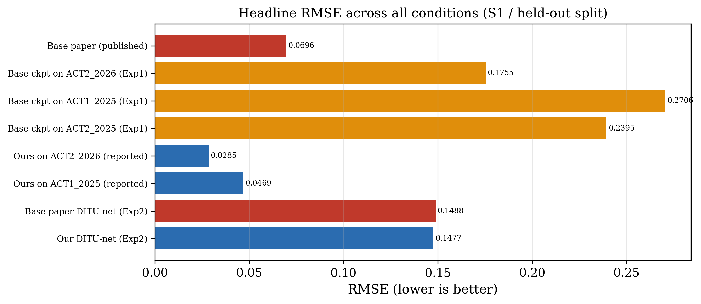

# Site-adapted U-Net for wind turbine power curve modeling

Research notebooks accompanying **Site-adapted U-Net and classical benchmarking for wind turbine power curve modeling under SCADA data quality variation**.

**Manuscript status:** Submitted to *Scientific Reports* (Nature Portfolio).

**Authors:** Syed Muhammad Hamza Tauqeer, Shibli Nisar, Armoghan Khan, and Ammad Jadoon. Department of Electrical Engineering, Military College of Signals, National University of Sciences and Technology, Pakistan.

## Overview

The site-adapted U-Net recovers a wind turbine capability curve from wind-speed–measured-power scatter. Historical controller-derived theoretical power (TP) forms training targets; frozen network inference uses wind speed and measured grid power (GP). TP is also an evaluation reference. Capability recovery and conditional power prediction are distinct tasks and their metrics should not be conflated.

The supplied workflows cover ACT-2 training, frozen ACT-2 inference, zero-shot ACT-1 transfer, and comparison with the released DITU-Net checkpoint using each pipeline's curve reader.

## Example experiment output



Saved checkpoint-comparison output; see [result provenance](docs/RESULTS_NOTES.md) before interpreting it as a final manuscript result.

## Notebooks

| Notebook | Purpose |
| --- | --- |
| [Training pipeline](notebooks/ditunet-complete-training-pipeline.ipynb) | ACT-2 training and development workflow |
| [ACT-2 inference](notebooks/unet-inference-testing-correct.ipynb) | Saved-checkpoint evaluation, 2026 scenarios, and component audits |
| [ACT-1 zero-shot inference](notebooks/ditunet-act1-zeroshot-inference.ipynb) | Frozen ACT-2 checkpoint applied to ACT-1 |
| [Checkpoint comparison](notebooks/ditu-net-baseline-comparison.ipynb) | Site-adapted and published DITU-Net pipelines |

Original filenames and all cell source text are preserved. Execution outputs and runtime metadata have been removed for readable version control. All repository figures come exclusively from the author-supplied `Github Repo Files.zip`. No notebook-embedded figures are included. The archive contains 132 figure files, 124 CSV/LaTeX table files, and 7 supporting records; all are retained with provenance in [the asset manifest](docs/asset-manifest.json).

## Reported manuscript results

**Result provenance:** The following manuscript values differ from some saved experiment exports. They are intentionally kept separate; see [result consistency notes](docs/RESULTS_NOTES.md).

| Frozen deployment, S1 | Turbine-months | Normalized RMSE | R² |
| --- | ---: | ---: | ---: |
| ACT-2 / 2026 | 100 | 0.02864 | 0.9946 |
| ACT-1 / 2025 | 240 | 0.05440 | 0.9578 |

These values are transcribed from supplied manuscript Table 2, Panel A, rather than recomputed here. [Scenario results](tables/manuscript_table2_panel_a.csv) include S1–S3. Controller capability is a proxy reference; the geographic scope is two fleets within one wind corridor.

## Getting started

Use a Kaggle GPU notebook environment, matching the original workflows, or provision an equivalent Python environment:

```bash
python -m venv .venv
source .venv/bin/activate
pip install -r requirements.txt
jupyter lab
```

The dependency list is inferred from imports and is not a frozen, validated environment. Select compatible PyTorch/torchvision builds for your GPU. Open the notebooks and configure their dataset/checkpoint paths before running cells in order. See [reproduction instructions](docs/REPRODUCIBILITY.md) for prerequisites and limitations.

## Data and model availability

ACT-1 and ACT-2 SCADA records are commercially confidential and are **not included**. Access requests are subject to data-provider approval and may be directed to the manuscript's corresponding author: stauqeer.msee24mcs@student.nust.edu.pk. Model checkpoints, generated image-pair training data, normalization files, and split metadata were not attached and are not bundled. Supplied experiment result CSVs, LaTeX tables, manifests, and environment records are included.

The external DITU-Net source and sample data are referenced at [IkeYang/DITU-net](https://github.com/IkeYang/DITU-net). Its code, weights, data, and licensing remain the responsibility of that upstream project; they are not redistributed here.

## Figures and tables

See [figure inventory](figures/README.md) and [table provenance](tables/README.md). Files are grouped by experiment rather than assigned unverified final-paper figure numbers. See the [figure gallery](docs/FIGURE_GALLERY.md) and [result consistency notes](docs/RESULTS_NOTES.md). The submitted manuscript PDF is not bundled.

## Validation

All code cells parse as Python and notebook cell sources match the supplied files. Training and inference have not been rerun: confidential data, checkpoints, and GPU runtime inputs are missing. Syntax checks alone do not establish numerical reproducibility. Run `python scripts/validate_notebooks.py` for static validation.

## Citation and reuse

Please cite the manuscript by its title and authors with the status **submitted manuscript** until a public preprint or published citation exists. A DOI and publication citation can be added when available. No software reuse license has been selected; no open-source license grant is implied. See [reuse notes](docs/REUSE.md).

## Repository layout

| Folder | Contents |
| --- | --- |
| `notebooks/` | Four supplied research workflows |
| `figures/` | All 132 supplied figure files, organized into five experiments |
| `tables/` | Supplied CSV and LaTeX exports plus separately labeled manuscript transcription |
| `results/` | Original manifests, environment information, and logs |
| `docs/` | Asset provenance, figure gallery, reproduction and result notes |
| `scripts/` | Static notebook validation |

Maintained for [Electromind18](https://github.com/Electromind18).
