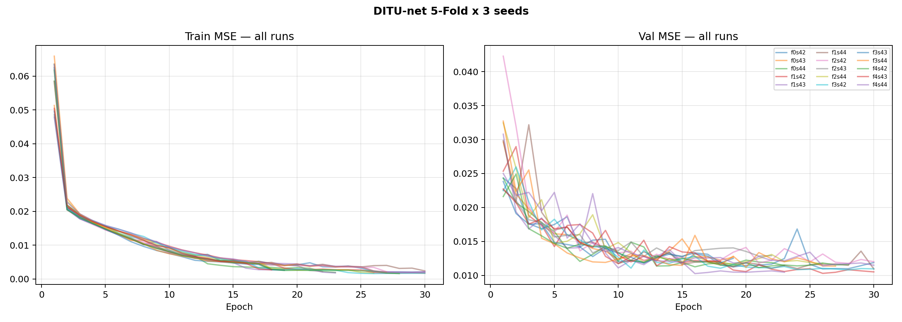
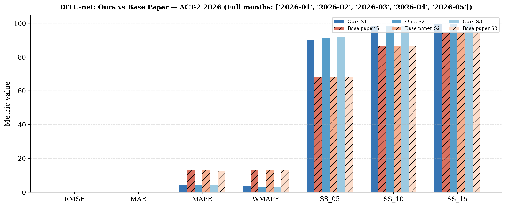
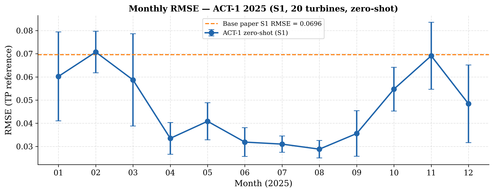
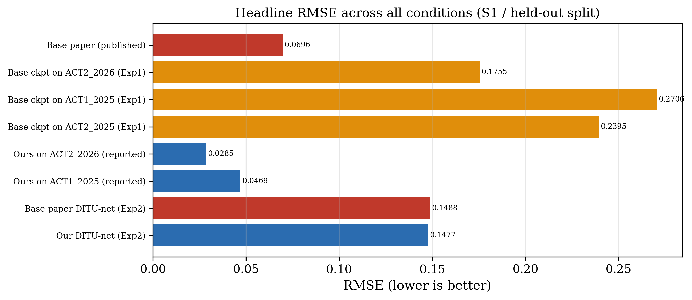
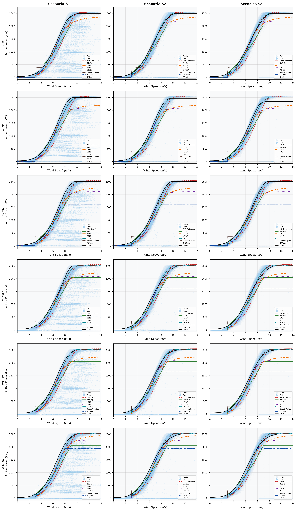

# Selected figure gallery

Representative supplied exports for navigation; these are not asserted to match final manuscript figure numbers. All 132 figure files remain in [the complete index](../figures/README.md).

## cv loss curves

## fig1 comparison bar 2026

## fig2 monthly rmse

## headline rmse

## Fig6 scenario comparison 6turbines

